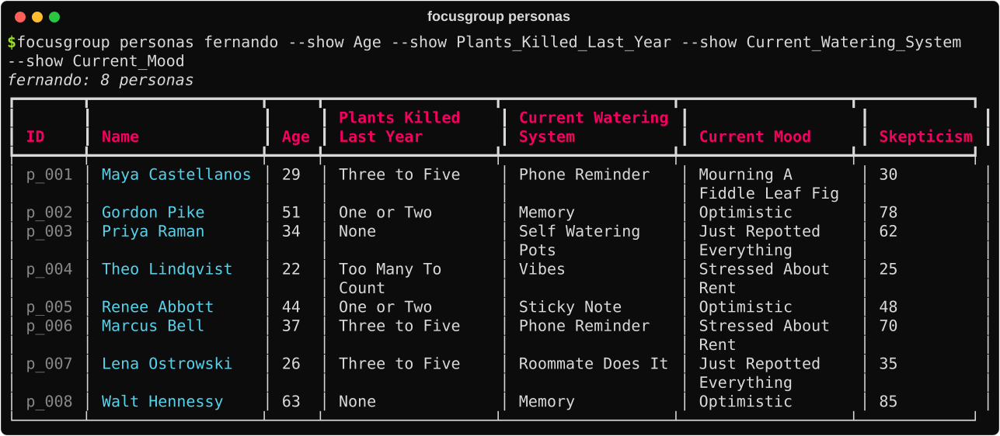
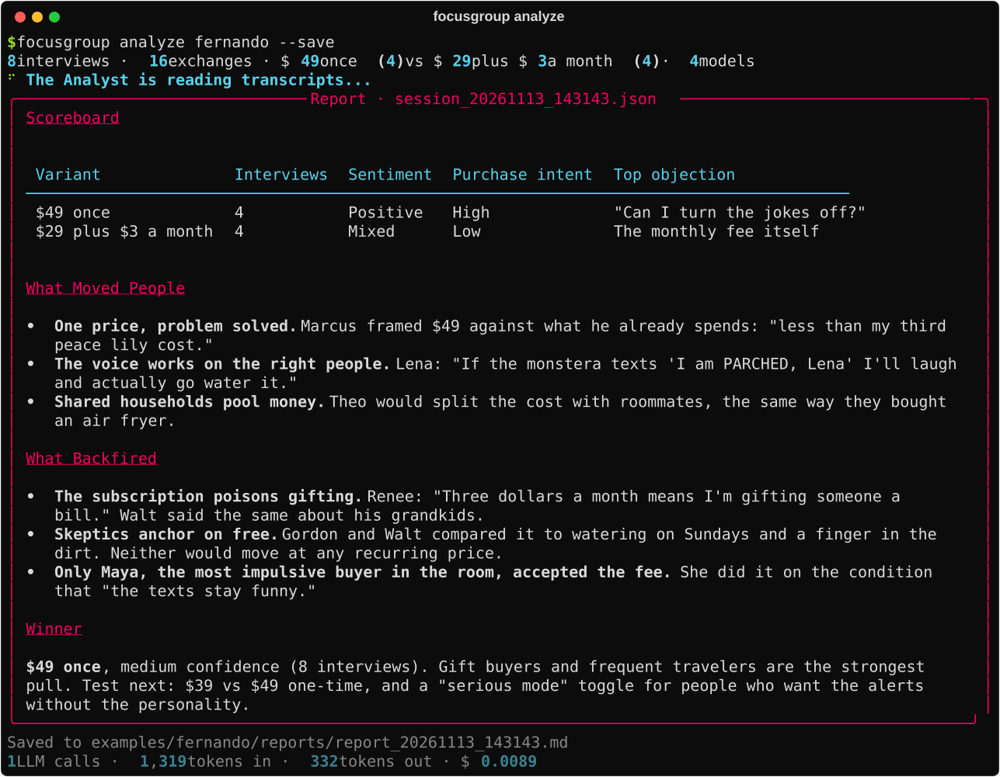

# focusgroup

**A focus group in your terminal.** Describe your product, and focusgroup casts a crowd of distinct, statistically controlled AI personas, interviews them in parallel across several LLMs, A/B tests your pricing and copy on them, and hands you a verdict.

[](https://github.com/joey12725/focusgroup/actions/workflows/ci.yml)

[](LICENSE)

<p align="center">
  
</p>

Eight people, two price points, four model families, one command. The run above is the bundled [`examples/fernando`](examples/fernando) project: a made-up soil sensor that texts you in your plant's voice.

## Why it's fun

Real customer interviews are the gold standard, and they take weeks to book. focusgroup is the warm-up lap. You can test twenty framings before lunch, find the objections you hadn't thought of, and walk into real interviews with sharper questions.

- **People built from math, not vibes.** A blueprint DSL (`{{ weighted(Severe:0.35, Medium:0.45, Low:0.2) }}`) controls the demographic mix exactly. The LLM only writes the backstory.
- **A mixed panel.** Every interview draws its model at random from your pool (GPT, Claude, Gemini, DeepSeek, Llama...), so one model's house style can't flatten the room.
- **Real conversations.** Scripted question sequences, improvised follow-ups (`--depth 2`), and `AGENT(...)` slots where a moderator model writes the next question from what was just said.
- **Split tests.** `--option '$49 once' --option '$29 plus $3 a month'` deals personas across variants and swaps each one into the `***` in your question.
- **The Mom Test built in.** `--mom` rewrites "Would you buy...?" into questions about past behavior, before any persona hears it.
- **A verdict, not a transcript dump.** An analyst model reports consensus, variance, outliers and Go / No-Go, or a scoreboard and a winner for split tests. Exact counts come from code, not the model.
- **Everything is a file.** Blueprints are YAML, personas are Markdown, sessions are JSON. Edit them, diff them, commit them.
- **Any OpenAI-compatible provider.** OpenRouter by default; OpenAI, Ollama, LM Studio and vLLM with one environment variable.

## Quickstart

```bash
# install (either works)
uv tool install git+https://github.com/joey12725/focusgroup
pipx install git+https://github.com/joey12725/focusgroup

# meet the bundled cast (no API key needed)
git clone https://github.com/joey12725/focusgroup && cd focusgroup
focusgroup personas examples/fernando

# add a key and interview them
echo 'OPENROUTER_API_KEY=sk-or-v1-...' > .env
focusgroup ask examples/fernando "Tell me about the last plant you lost." --sample 5 --depth 1
focusgroup analyze examples/fernando
```

Then start your own:

```bash
focusgroup init my-idea --desc "A budgeting app for college students who want to travel"
focusgroup generate my-idea --count 30
focusgroup ask my-idea "How did you pay for your last trip?" --sample 12 --depth 2
focusgroup analyze my-idea --save
```

## A full run, start to finish

**1. The brief.** [`examples/fernando/brief.md`](examples/fernando/brief.md):

> Fernando is a soil sensor about the size of a golf tee. You push it into any pot and it texts you, in your plant's own voice, when the plant needs water, more light, or a little encouragement...

**2. The blueprint.** `focusgroup init` turns the brief into [`blueprint.yaml`](examples/fernando/blueprint.yaml), a set of dice for who is in the room:

```yaml
Plants_Killed_Last_Year: "{{ weighted(None:0.15, One_or_Two:0.4, Three_to_Five:0.3, Too_Many_To_Count:0.15) }}"
Current_Watering_System: "{{ choice(Memory, Phone_Reminder, Sticky_Note, Roommate_Does_It, Self_Watering_Pots, Vibes) }}"
Subscription_Fatigue: "{{ weighted(Low:0.2, Medium:0.45, Severe:0.35) }}"
Current_Mood: "{{ choice(Optimistic, Stressed_About_Rent, Just_Repotted_Everything, Mourning_A_Fiddle_Leaf_Fig) }}"
```

**3. The cast.** `focusgroup generate fernando --count 8` rolls the dice and writes each person ([example](examples/fernando/personas/p_008.md)):

<p align="center"></p>

**4. The interviews.** The split test at the top of this page. Every transcript is saved to [`sessions/`](examples/fernando/sessions).

**5. The verdict.** `focusgroup analyze fernando --save`:

<p align="center"></p>

## How personas are generated

Personas come from two layers on purpose:

1. **Skeleton (Python).** The blueprint's `range`, `choice`, `weighted`, `normal` and `bool` templates are rolled with a seeded RNG. If the blueprint says 35% of the room has severe subscription fatigue, about 35% does. `--seed` makes the whole mix reproducible.
2. **Flesh (LLM).** The writer model gets the skeleton and invents the person who fits it: a name, a skepticism score, a one-line quote, how they buy, and what would make them walk. Every attribute is kept verbatim in the YAML front matter.

The Architect drafts the blueprint from your brief and validates it before saving. It's plain YAML, so tune the odds by hand whenever you like.

## How results are aggregated

Each `ask` writes one JSON session with every turn of every conversation, the persona, the model and the variant. `analyze` then works in two layers:

- **Tally (exact, no LLM):** interviews, failures, exchanges, interviews per variant, models used.
- **Synthesis (LLM, fixed rubric):**
  - *Single question:* **Consensus** (60%+ agreement, with shares like "7 of 10"), **Variance**, **Outliers**, **Verdict** (Go / No-Go / Pivot, plus the next question to ask real customers).
  - *Split test:* transcripts are grouped by variant into a **Scoreboard** (sentiment, purchase intent, top objection), **What Moved People**, **What Backfired** and a **Winner** with a confidence level.
  - *Batch:* one section per test.

## Provider configuration

Drop a key in `.env` and go. Everything else is optional:

| Setting | Env var | Default |
|---|---|---|
| API key | `FOCUSGROUP_API_KEY`, `OPENROUTER_API_KEY` or `OPENAI_API_KEY` | |
| Endpoint | `FOCUSGROUP_BASE_URL` | `https://openrouter.ai/api/v1` |
| Interview pool | `FOCUSGROUP_MODELS` (comma-separated) | `openai/gpt-5-mini` |
| Report model | `FOCUSGROUP_ANALYST_MODEL` | first model in the pool |
| Parallelism | `FOCUSGROUP_CONCURRENCY` | `8` |

Or commit a [`focusgroup.ini`](focusgroup.example.ini) that names the key's env var instead of holding it. Running fully local:

```bash
FOCUSGROUP_BASE_URL=http://localhost:11434/v1 FOCUSGROUP_API_KEY=ollama \
FOCUSGROUP_MODELS=llama3.1:8b,qwen2.5:7b focusgroup ask my-idea "..."
```

Every command ends with a token and dollar tally, using provider-reported costs when available.

## Command cheat sheet

| Command | What it does |
|---|---|
| `focusgroup init NAME --desc/--brief` | Architect drafts `blueprint.yaml` from your brief |
| `focusgroup generate NAME -n 30 --seed 7` | Roll skeletons and write personas, in parallel |
| `focusgroup personas NAME --show Age --show Mood` | Table of the cast |
| `focusgroup ask NAME "Q" -s 12 --depth 2 --mom` | Interview a random sample |
| `focusgroup ask NAME "Pay ***?" -o A -o B` | Split test |
| `focusgroup batch NAME guide.yaml` | Run a whole interview guide ([example](examples/fernando/batch.yaml)) |
| `focusgroup analyze NAME --save` | Tally plus the Analyst's report |

Full reference: [docs/usage.md](docs/usage.md).

## Under the hood

Python 3.10+, [Typer](https://typer.tiangolo.com) for the CLI, [Rich](https://github.com/Textualize/rich) for the terminal UI, the [OpenAI SDK](https://github.com/openai/openai-python) against any compatible endpoint, `asyncio` with a semaphore for parallel interviews, and PyYAML for blueprints and front matter. Tests run the whole CLI end to end against a scripted fake model, so CI never touches the network.

```
focusgroup/
├── cli.py               commands and terminal UI
├── config.py            provider settings (ini + env)
├── llm.py               OpenAI-compatible client + cost tracking
├── blueprint_parser.py  the dice DSL
├── architect.py         brief -> blueprint
├── persona_generator.py skeleton -> persona
├── simulation.py        interviews, follow-ups, split tests
├── mom_test.py          question rewriting
├── analyst.py           tally + report rubrics
└── project.py           on-disk layout
```

More: [Architecture](docs/architecture.md) · [Configuration](docs/configuration.md) · [Usage](docs/usage.md) · [Extending](docs/extending.md)

## Development

```bash
uv venv && uv pip install -e ".[dev]"
uv run pytest
uv run ruff check . && uv run ruff format --check .
```

---

Built by [Joey Hersh](https://github.com/joey12725). MIT licensed.
