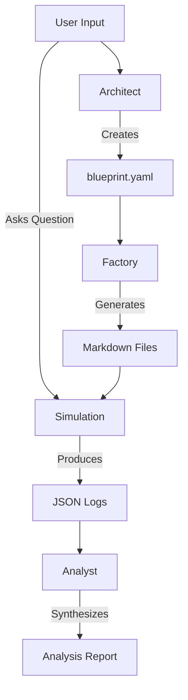

# System Architecture

VibeTest operates on a **"Hybrid Generation"** model. This approach balances statistical control (to ensure representative sampling) with generative AI (to provide narrative depth and realistic behavior).

## Core Components

The system is built on four main pillars:

### 1. The Architect (Initialization)
*   **Role**: Translates your high-level product idea into a concrete demographic blueprint.
*   **Process**: It analyzes your project description and determines 3-5 key psychographic variables (e.g., "Risk Tolerance", "Tech Savviness") that would impact buying decisions.
*   **Output**: A `blueprint.yaml` file containing the "DNA" of your customer base using a custom Domain Specific Language (DSL).

### 2. The Factory (Generation)
*   **Role**: Mass-produces individual personas based on the blueprint.
*   **Process**:
    1.  **Skeleton Generation (Python)**: Executes the deterministic math in the blueprint (e.g., `{{ weighted('Admin': 0.8, 'Manager': 0.2) }}`) to create valid statistical profiles.
    2.  **Flesh Generation (LLM)**: Takes the raw stats (Skeleton) and "hallucinates" the narrative flesh—explaining *why* the data points exist.
*   **Output**: Individual Markdown files (e.g., `personas/p_023.md`) rich with metadata and backstory.

### 3. The Simulation (Interview)
*   **Role**: Conducts customer interviews at scale.
*   **Process**:
    *   **Sampling**: Randomly selects a subset of personas.
    *   **Execution**: Uses `asyncio` to run parallel interviews.
    *   **The Mom Test**: Optionally rewrites your questions to be past-tense and behavioral to avoid bias.
    *   **Split Testing**: Can inject different variable options into the prompt to test how different cohorts respond.
*   **Output**: A JSON log of the session containing all Q&A pairs and conversation history.

### 4. The Analyst (Synthesis)
*   **Role**: Makes sense of the noise.
*   **Process**: Reads the session logs and uses an analytical LLM to find patterns.
*   **Output**: A synthesized report identifying:
    *   **Consensus**: What most personas agree on.
    *   **Variance**: Where the audience is split.
    *   **Outliers**: Unique, unexpected insights.
    *   **Recommendation**: A "Go/No-Go" verdict based on the data.

## Data Flow Diagram

