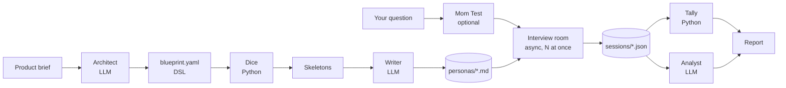

# Architecture

focusgroup splits the work between plain Python and the LLM. Code handles anything that needs to be exact: who is in the room, what each person is asked, who saw which variant, and the counts. The model handles the parts that need imagination: writing each person's backstory, playing them in conversation, and reading the transcripts like an analyst.



## 1. Architect (`focusgroup init`)

`architect.py` sends your brief to the default model with a strict prompt: return a flat YAML map where every value is one DSL call. It asks for demographics, three to five psychographic variables that would change a buying decision for this product, and one or two "life randomizers" such as mood or a recent event.

The response is validated before it is saved. It is parsed as YAML and rolled once through the dice. If that fails, the model gets the error and one chance to fix it. The blueprint is plain YAML, so you can edit it before generating anyone.

## 2. Dice (`blueprint_parser.py`)

Each `{{ ... }}` template is evaluated with Python's `random` module. Nothing is `eval`'d: arguments go through `ast.literal_eval` and bare words stay strings.

| Function | Result | Example |
|---|---|---|
| `range(min, max)` | uniform integer, inclusive | `{{ range(1, 45) }}` |
| `choice(a, b, ...)` | uniform pick | `{{ choice(Memory, Sticky_Note, Vibes) }}` |
| `weighted(k:w, ...)` | weighted pick; weights need not sum to 1 | `{{ weighted(None:0.15, One_or_Two:0.4) }}` |
| `normal(mean, std)` | integer from a bell curve | `{{ normal(72000, 22000) }}` |
| `bool(p)` | `true` with probability `p` | `{{ bool(0.35) }}` |

Templates embedded in longer strings are substituted as text (`"Age {{ range(20, 30) }}"`). Nested maps are rolled recursively.

All skeletons for a `generate` run are rolled up front with one seeded RNG. Pass `--seed` and the demographic mix is identical every time, even though the LLM calls that follow finish in any order.

## 3. Writer (`persona_generator.py`)

Each skeleton goes to the default model with a "novelist casting a focus group" prompt. It keeps every attribute exactly as given, then invents a name, a skepticism score from 0 to 100, a one-line quote and three short sections: context, how they buy, and what would make them walk away. Calls run concurrently under a semaphore (`concurrency`, default 8), and files are numbered after any personas already in the project, so `generate` is additive.

A persona file is Markdown with YAML front matter:

```markdown
---
name: Walt Hennessy
Age: 63
Plants_Owned: 38
Subscription_Fatigue: Severe
skepticism: 85
---

> "Stick your finger in the dirt. That's the sensor. It's free."

## The Context
...
```

## 4. Interview room (`simulation.py`)

`ask` samples `--sample` personas at random without replacement. Each interview:

1. picks a model at random from the configured pool, so a panel of ten might be answered by four different model families;
2. walks the question queue: your scripted question(s) (split on `|||`), then `--depth` improvised follow-ups;
3. sends the persona the full profile as a system prompt and the conversation so far, with the interviewer as `user` and the persona as `assistant`.

Special queue items:

- **`AGENT(instruction)`**: a moderator model writes the next question from the instruction and the conversation so far. Use it for "ask about whatever they just complained about".
- **`None` / depth slots**: a "sharp customer-discovery interviewer" prompt writes one probing follow-up about the last answer.

**Split tests.** With `--option A --option B`, personas from the random sample are dealt round-robin across the variants and `***` in the question is replaced with that persona's variant. Since the sample is random, the deal is random assignment with equal group sizes.

Interviews run concurrently. A failed call marks only that interview as `error`. The rest of the panel carries on, and errors are shown in the table and excluded from analysis.

## 5. Aggregation (`analyst.py`)

`analyze` works in two layers.

**Tally (exact).** `tally()` counts interviews, successes, failures, exchanges, interviews per variant and interviews per model straight from the session JSON. That line prints before the report, so the numbers never depend on the model.

**Synthesis (LLM).** All successful transcripts go to the report model (`analyst_model`, or the default model if unset) with a fixed rubric:

| Session type | Rubric sections |
|---|---|
| Single question | **Consensus** (60%+ agreement, with rough shares), **Variance**, **Outliers**, **Verdict** (Go / No-Go / Pivot plus the next question to ask real customers) |
| Split test | **Scoreboard** table (sentiment, intent, top objection per variant), **What Moved People**, **What Backfired**, **Winner** with a confidence level |
| Batch | One section per test, each using the matching rubric |

Transcripts are grouped by variant for split tests, so the analyst compares the groups side by side rather than reading one undifferentiated pile.

## 6. Storage

Everything is files, so projects can be diffed, committed and shared:

```
projects/<name>/
├── brief.md
├── blueprint.yaml
├── personas/p_001.md ...
├── sessions/session_<timestamp>.json   # ask
├── sessions/batch_<timestamp>.json     # batch
└── reports/report_<timestamp>.md       # analyze --save
```

`analyze` picks the newest session by the timestamp in its filename. See [`examples/fernando/sessions`](../examples/fernando/sessions) for the exact JSON shape.

## 7. Provider layer (`llm.py`, `config.py`)

Every component talks to the model through `LLM.complete` / `LLM.acomplete`, a thin wrapper over the OpenAI SDK pointed at any OpenAI-compatible `base_url`. That wrapper also tracks tokens and cost: it uses the provider-reported cost when there is one (OpenRouter reports it) and a small price table otherwise. Clients are created lazily, so `--help`, `personas` and the tests never need a key.
